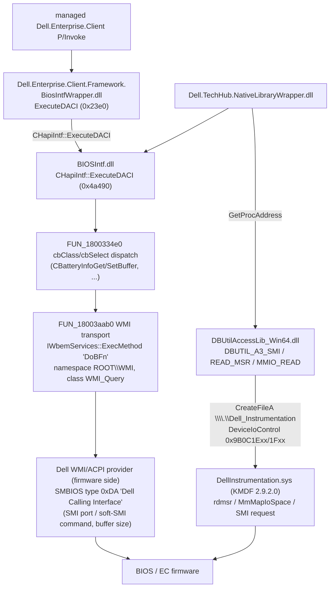

# 05 — Native BIOS interface (Dell Optimizer 6.3.5.0)

Scope: the five native DLLs that implement the Dell "Dell API Calling Interface" (DACI) bridge used by
the managed layer (`BiosIntfStatus ExecuteDACI(void* hObj, uint16 cbClass, uint16 cbSelect, MarshalBiosData*, wchar* pwd, PwdType)`),
plus the kernel driver that backs the raw MSR/MMIO/SMI path (`DellInstrumentation.sys`).

All findings below come from Ghidra 12.1.2 headless analysis (import + full auto-analysis + decompilation
dump) of the binaries under `extract/`. Per-binary Ghidra projects are kept in `ghidra/projects/`
(`BiosIntfWrapper`, `BIOSIntf_app`, `BIOSIntf_dtp`, `DBUtilAccessLib`, `TechHubWrapper`,
`DellInstrumentation`); complete decompilation dumps (every function, header metadata, xrefs) are in:

| Dump | Binary |
|---|---|
| `ghidra/decompiled_BiosIntfWrapper.c` (869 fns) | `extract/app/.../DellOptimizer/Dell.Enterprise.Client.Framework.BiosIntfWrapper.dll` |
| `ghidra/decompiled_BIOSIntf_app.c` (2318 fns) | `extract/app/.../DellOptimizer/BIOSIntf.dll` |
| `ghidra/decompiled_DBUtilAccessLib_Win64.c` (507 fns) | `extract/pkg_coreservices/.../InstrumentationSubAgent/DBUtilAccessLib_Win64.dll` |
| `ghidra/decompiled_BIOSIntf_dtp.c` (2295 fns) | `extract/pkg_coreservices/.../InstrumentationSubAgent/BIOSIntf.dll` |
| `ghidra/decompiled_TechHub_NativeLibraryWrapper.c` (448 fns) | `extract/pkg_coreservices/.../InstrumentationSubAgent/Dell.TechHub.NativeLibraryWrapper.dll` |
| `ghidra/decompiled_DellInstrumentation_sys.c` | `extract/pkg_coreservices/.../DBUtilDriver/DellInstrumentation.sys` |

Addresses are stated as image base `0x180000000` + RVA for the DLLs (x64 PE default), `0x140000000` for
the driver. Status codes observed in the shared `enum Status`: `0` OK, `1` request-failed (response
status dword ≠ 0), `3` error / not supported, `9` COM init failed, `0xA` WMI instance not found,
`0xB` SMBIOS tables unavailable, `0xD` not admin, `0xF` PLDM init failed, `0x10` ACPI interface not
supported, `0x13` invalid parameter (NULL handle / bad PWDTYPE).

## Architecture at a glance

Two independent hardware paths exist:

1. **DACI path** (used for the battery charge-level settings): managed → `BiosIntfWrapper.dll` →
   `BIOSIntf.dll` → WMI `root\wmi` class `WMI_Query`, method `DoBFn` → Dell ACPI/WMI provider → BIOS
   calling interface (SMBIOS type 0xDA). No `DeviceIoControl` is involved — `BIOSIntf.dll` imports no
   IOCTL API at all (only `CreateFileW` for CRT use).
2. **DBUtil path** (used by the TechHub wrapper for MSR/MMIO/A3-SMI telemetry): `DBUtilAccessLib_Win64.dll`
   → `\\.\Dell_Instrumentation` IOCTLs → `DellInstrumentation.sys` → `rdmsr` / `MmMapIoSpace` / SMI.

---

## 1. `Dell.Enterprise.Client.Framework.BiosIntfWrapper.dll` (#1)

* 266,976 B, x64, PDB `C:\home\runner\_work\uue\uue\uue\Module\auxiliary\src\Dell.Enterprise.Client.Framework.BiosIntfWrapper\bin\x64\Release\Dell.Enterprise.Client.Framework.BiosIntfWrapper.pdb`.
* Imports: `BIOSIntf.dll` (19 C++ methods of `CHapiIntf`/`CDiagsIntf`/`PDC`/`CTP`/`DDS`), KERNEL32, ole32
  (COM for WMI use inside BIOSIntf), OLEAUT32. No DeviceIoControl, no registry.
* Interesting strings: `Make sure the Release/Debug version of BiosInfo is the same with your project setting.`,
  `BiosIntfWrapper: <fn> failed.` log lines, `SELECT * FROM MSSMBios_RawSMBiosTables`, `ROOT\WMI`,
  `SMBiosData` (SMBIOS read-back helper), RTTI types `IBIOSData`, `SimpleTokenDataExt`, `AdvBatteryInfoExt`,
  `PeakShiftConfig`, `BATTERY_INFO`.
* Constants: `Status 0x13` = invalid handle / bad PWDTYPE; PWDTYPE accepted range `0..7`.

### 1.1 Exported functions (18)

| # | Export | Addr | Signature | Logic summary |
|---|---|---|---|---|
| 1 | `CreateBiosIntf` | 0x2350 | `CHapiIntf* f()` | heap-alloc 0x38, zero, `CHapiIntf::CHapiIntf(ostream*)` from BIOSIntf.dll; returns the object handle |
| 2 | `CreateDiagsIntf` | 0x8380 | `CDiagsIntf* f()` | lazily (per-thread, TLS init) constructs a static `std::ofstream` then `CDiagsIntf::CDiagsIntf(ostream*)`; returns object |
| 3 | `DeleteBiosIntf` | 0x23b0 | `void f(CHapiIntf*)` | `~CHapiIntf` + heap free; NULL-safe |
| 4 | `DeleteDiagsIntf` | 0x83c0 | `void f(CDiagsIntf*)` | `~CDiagsIntf` + free |
| 5 | `EnableDKLEvents` | 0x4270 | `void f(int)` | forwards `CTP::EnableDKLEvents(bool)` (BIOSIntf.dll) |
| 6 | `ExecuteDACI` | 0x23e0 | `Status f(CHapiIntf*, ushort cbClass, ushort cbSelect, int* marshalData, char* pwd, PWDTYPE)` | **the battery entry point**; see §1.2. Returns 0x13 for NULL handle or PWDTYPE>7; dispatches on `marshalData[0]` (`biosDataType`); on success clears `marshalData[0x1e]` (Status) |
| 7 | `ExecuteDiags` | 0x83f0 | `Status f(CDiagsIntf*, uint*, uchar*, …)` | forwards `CDiagsIntf::Execute` (4 length/buffer pairs) |
| 8 | `GetAttribute` | 0x34d0 | `int64 f(CHapiIntf*, void* name, int64* value)` | PLDM attribute read by name; calls `IsPLDMSupported`, `CHapiIntf::GetAttributeValue` with name→handle resolution, `OutputDebugStringA` on failure paths |
| 9 | `GetDeviceState` | 0x4090 | `Status f(CHapiIntf*, uint* out2)` | `CHapiIntf::GetDeviceState`; unpacks `DeviceState` bit0 → out[0], bit1 → out[1] |
| 10 | `GetPerformanceDischargeCapabilityStatus` | 0x41b0 | `Status f(uint*)` | forwards `PDC::GetStatus` (BIOSIntf.dll) |
| 11 | `GetToken` | 0x2c00 | `Status f(CHapiIntf*, ushort tokenId, int* tokenData)` | validates token id via lookup `FUN_180007e30`, builds `SimpleTokenDataExt` (9 dwords from tokenData[1..9]), calls `CHapiIntf::ExecuteDACI(h, 0, 0, …, pwd "", PWDTYPE 0)`, copies results back |
| 12 | `InitializeBiosIntf` | 0x2390 | `Status f(CHapiIntf*)` | `CHapiIntf::Init(true,true,true)`; 0x13 on NULL |
| 13 | `InitializeDiagsIntf` | 0x84a0 | `Status f(CDiagsIntf*)` | `CDiagsIntf::Init()`; 0x13 on NULL |
| 14 | `SetAttribute` | 0x3a50 | `Status f(CHapiIntf*, void* name, void* value)` | PLDM attribute write; resolves handle, validates admin password (`GetPwdInfo`/`ValidatePwd` helpers `FUN_180002df0`), `CHapiIntf::SetAttributeValue` |
| 15 | `SetDOStatus` | 0x42d0 | `void f(uint)` | forwards `DDS::SetDOStatus` |
| 16 | `SetPerformanceDischargeMode` | 0x4220 | `void f(uint)` | forwards `PDC::SetMode` |
| 17 | `SetPrivacyScreen` | 0x4150 | `Status f(CHapiIntf*, int)` | `CHapiIntf::SetPrivacyScreen(bool)` |
| 18 | `SetToken` | 0x2e70 | `Status f(CHapiIntf*, ushort, int* tokenData, ushort)` | like `GetToken` but write direction (arg 4 selects it); also consults `GetPwdInfo` |

### 1.2 `ExecuteDACI` marshaling (0x23e0)

`int* param_4` is the managed `MarshalBiosData` seen as dwords/bytes. `param_4[0]` selects the
`IBIOSData` subclass instantiated inside the call:

| `biosDataType` | IBIOSData class (RTTI) | Field mapping (managed byte offset → object offset) |
|---|---|---|
| 0 | `SimpleTokenDataExt` | dwords +0x04..+0x24 (9) → obj+0x08..+0x28 |
| 1 | `AdvBatteryInfoExt` | dwords +0x04..+0x23 (8, TokenData region) → obj+0x08..+0x24; dword +0x24 (`Version`) **dropped** (obj+0x28 = 0); dwords +0x28..+0x47 (8: `Sun..Sat` daily masks + 1) → obj+0x38..+0x54; byte +0x48 `m_nBatteryCommand` → obj+0x30; byte +0x49 `m_nBatteryNumber` → obj+0x32; byte +0x4A `m_nChargingMode` → obj+0x58; byte +0x4B `m_nStartChrgLimit` → obj+0x59; byte +0x4C `m_nStopChrgLimit` → obj+0x5A |
| 2 | `PeakShiftConfig` | dwords +0x04..+0x23 → obj+0x08..+0x24; byte +0x70 `cmd` → obj+0x30, +0x71 `num` → obj+0x32, +0x72 flag, +0x73..+0x75; dwords +0x50..+0x6F (8) → obj+0x38..+0x54 |

After `CHapiIntf::ExecuteDACI` returns, all fields are copied back to `param_4` in place (so a
read/select-18 response lands in the managed struct), and `param_4[0x1e]` (managed `Status`) is zeroed
on success. This matches the managed `MarshalBiosData`/`AdvanceBatteryConfig` (Pack=4) layout with
`m_nBatteryCommand` at +0x48 etc.

---

## 2. `BIOSIntf.dll` (#2, `extract/app/.../DellOptimizer/`)

* 1,043,160 B, x64, build stamp 0x6A444265 (2026-07), PDB `C:\home\runner\_work\biostesttool\biostesttool\HapiIntf\x64\Release\BIOSIntf.pdb`.
* Imports: KERNEL32 (incl. `GetSystemFirmwareTable` for SMBIOS), ADVAPI32 (`RegOpenKeyExA`/`RegQueryValueExA`
  — used for `SOFTWARE\Dell\BIOSIntfLog` logging config — plus event log and `CheckTokenMembership` for
  admin test), ole32 (`CoCreateInstance`, `CoInitializeSecurity`, `CoSetProxyBlanket` — WMI), OLEAUT32
  (BSTR/SAFEARRAY). **No DeviceIoControl.**
* WMI namespaces used (unicode strings, with xrefs in the dump):
  * `ROOT\WMI` — `CHapiIntf::InitializeCOM`, AWCC and BatteryAnalytics connections. DACI transport
    namespace. Classes seen: `WMI_Query` (instance enumeration + `ConvertPathToInstanceName`),
    `MSSMBios_RawSMBiosTables` (`SELECT * FROM MSSMBios_RawSMBiosTables`), `AWCCWmiMethodFunction`.
  * `ROOT\DCIM\SYSMAN\ECINTERFACE` — EC MMIO / PDC / DDS / CTP / RCC calls, XML payload
    `<ECIO><DDVWmiMethodFunction>…</DDVWmiMethodFunction></ECIO>` with elements `<ECMMIO>Buffer|Command</ECMMIO>`,
    `<PDC>…`, `<DOLoadState>`, `<DKL-EnableEvents>`, `<RCCLoadState>`.
  * `ROOT\DCIM\SYSMAN\DIAGNOSTICS` — WMI class `LegacyDiags`, method `Execute` (args `EcxLen`, `EcxVal`).
  * `ROOT\DCIM\SYSMAN\IQ` — BIOS IQ log XML `<BIOSIQ>…</BIOSIQ>` (`GetInfoInstanceCount`,
    `GetAlertInstanceCount`, `GetLogControlPolicy`, `GetBiosIqPolicy`, `SetBiosIqPolicy`, …).
  * `ROOT\DCIM\SYSMAN` (used by `DDS` connection helper `FUN_180043e30`).
* Other notable strings: `SOFTWARE\Dell\BIOSIntfLog`, `BIOSIntf_DACI_A3_Info`, `<DACI>`/`<A3>` timing tags
  (`<BIOSTimeMicroSecond>`, `<ACPITimeMilliSecond>`), `Software SMI port = 0x`, `Calling interface soft SMI value = 0x`,
  `Supported classes = 0x` (SMBIOS type 0xDA "Dell Calling Interface" table parse output), and the
  test-tool interactive prompts (`Enter the Battery Command (cbArg1, byte 0) : ` etc.).
* Key statics (exported): `m_mapBIOSTable` (map SMBIOS table type byte → `CBIOSObject*` parser),
  `m_bstrACPIInstanceName`, `m_dwACPIBufSize`, `m_bIsWMIACPIBufferFixPresent`, `m_SMBIOSMajor/MinorVersion`,
  `bFlagCheck`, `CBIOSObject::ErrorCount`, `m_nRefCount`.

### 2.1 `CHapiIntf::ExecuteDACI` — core DACI engine (0x4a490)

Signature: `Status CHapiIntf::ExecuteDACI(ushort cbClass, ushort cbSelect, IBIOSData& data, const string& pwd, PWDTYPE pwdType)`.

1. `CoInitializeEx(0, COINIT_MULTITHREADED)`; on any exit `CoUninitialize` if it succeeded here.
2. Looks up `m_mapBIOSTable[0xDA]` — the SMBIOS **type 0xDA** "Dell Calling Interface" table parser
   ("DA Type Object"; error string `Unable to get DA Type Object!`) and `dynamic_cast`s it
   (`FUN_180090684`, error `Down cast failed!`).
3. If `cbClass != 0x40 && cbClass != 0x32`: requires `FUN_18003c770(daObj, cbClass)` — walks the
   0xDA table's attribute map for the 17-char key **`SupportedCommands`**, parses its value as a
   base-10 mask and tests bit `cbClass` (`(mask >> cbClass) & 1`). Fail → Status 3.
4. Password stage (only when `pwd` non-empty): `FUN_180073000` + `FUN_180073460` (calls the same
   transport `FUN_18003aab0`) validate the password against the ACPI interface.
5. Composite-select special cases (each forces a second DACI with cbClass 3/select 2):
   `cbClass==3` select 9/11 and 3/4; `cbClass==0x0B` select 8; `cbClass==0x11` select in
   `{5,20,22,24}` (bitmask 0x1450020); `cbClass==0x1A` select 2 with data field == 0;
   `cbClass==0x1C` select 3. (Battery class 8 is not special-cased.)
6. Main path: `builder = FUN_1800334e0(ctx, cbClass, cbSelect, m_dwACPIBufSize)` (§2.2),
   `buf = builder->vft[1](builder, flags, &status, &data)` (BuildBuffer),
   `FUN_18003aab0(daObj, buf, m_dwACPIBufSize, &m_bstrACPIInstanceName)` (§2.3 transport).
7. If transport OK and `*(uint*)(buf + 0x14) == 0` (status dword): `builder->vft[4](builder, &data)`
   (ProcessResponse into the IBIOSData) → return 0. Else `FUN_180033400` (error copy) → return 1.
   `builder->vft[6](builder, 1)` destroys the builder.

### 2.2 cbClass/cbSelect dispatch table — `FUN_1800334e0` (0x334e0)

Allocates (heap, `FUN_18008dd58`) and constructs one of the `CBIOSObject`-style ABI buffer classes per
(cbClass, cbSelect); the constructor `FUN_180032a60(buf, cbClass, cbSelect, acpiBufSize)` is the
generic base. Entries observed in the switch (select values decimal):

| cbClass | cbSelect(s) | Buffer class (ctor) | Notes |
|---|---|---|---|
| 0, 1, 4, 0x10, 0x12, 0x13, 0x16, 0x1E | any | generic `FUN_180032a60` | token/misc |
| 2 | 0 / 1 | generic / `FUN_180047920` | |
| 3 | 0–2, 5–7, 12–13 (mask 0x2587) | generic | |
| 3 | 3–6 except 4/6 | `FUN_180051880` | boot config |
| 3 | 9–12 except 10 | `FUN_180083910` | |
| 5 | 3–6 | `FUN_180013870` | |
| 6 | 1–3 / 5 / other | `FUN_180028290` (`CBFABuffer`) / `FUN_180047920` / generic | |
| 7 | 3 / 4 / 5–9 / 10 / other | `FUN_180047440` / generic / `FUN_180028680` / `FUN_180047920` / generic | |
| **8** | **0–17, 20** | **generic `FUN_180032a60`** | battery info generic |
| **8** | **18 (0x12)** | **`FUN_180027640` → `CBatteryInfoGetBuffer`** | **charge-level READ** |
| **8** | **19 (0x13)** | **`FUN_180027d70` → `CBatteryInfoSetBuffer`** | **charge-level WRITE** |
| 9 | 4–5 / other | `FUN_180060ea0` / generic | |
| 10 | selects in mask 0x783B0 / 0xD0006800 / 21–24 | `FUN_180060ea0` / `FUN_18004d8d0` / error `PBA DB Handler is not implemented...` | |
| 0x0B | 0–1 / 2–3 / 4–5 / 6–7 / 8–9 | generic / `FUN_18001c230` / `FUN_18004ed40` / `FUN_18001d7c0` / `FUN_180081150` | |
| 0x0C | 4–5 / other | `FUN_180060ea0` / generic | |
| 0x0F | 8 / other | `FUN_180047920` / … | |

RTTI names of the special classes (`CBatteryInfoGetBuffer`, `CBatteryInfoSetBuffer`, `ADV_BATT_CONFIG`,
`PEAK_SHIFT_CONFIG`, `BATTERY_INFO`, `CBFABuffer`, …) confirm the battery meaning of class 8 / selects
18–19.

### 2.3 WMI transport — `FUN_18003aab0(daObj, buffer, bufSize, instanceNameBSTR)` (0x3aab0)

The single place DACI reaches "hardware". Requires the daObj WMI handles (fields +0x48, +0x58, +0x60,
+0x68, +0x78 non-NULL):

1. Sets `buffer[0x14..]` status dword = `0xFFFFFFFD` ("in flight"); if enabled (`DAT_1800f5b28`) also
   writes a header `0xB10D` marker before the buffer.
2. `FUN_18003b900(daObj, buffer, bufSize)`: copies the buffer into a `VT_ARRAY|VT_UI1` (0x2011) VARIANT
   and `IWbemClassObject::Put` (vtable+0x28) property **`"Bytes"`** (and a `"Data"` BSTR property on the
   in-params object).
3. Builds the method object path from the wide string `"BFn"` combined with the ACPI instance name
   (`m_bstrACPIInstanceName`, produced by `CHapiIntf::FindInstanceAndGetData`/`ConvertPathToInstanceName`
   from the `WMI_Query` instance in `ROOT\WMI`), then calls
   `IWbemServices::ExecMethod` (vtable+0xC0) with method name **`"DoBFn"`**.
4. `FUN_18003c180(daObj, buffer)`: reads the output object property `"Data"` (an embedded
   IWbemClassObject, QI via IID at 0x1800bfce8), then its `"Bytes"` (`VT_ARRAY|VT_UI1`),
   `SafeArrayAccessData` + copy into the ABI buffer (`FUN_180039c40`).
5. Also performs timing capture (`<DACI>`/`<ACPITimeMilliSecond>` XML log fragments).

`CHapiIntf::FindInstanceAndGetData` (0x4a900) enumerates WMI class **`WMI_Query`**
(`IWbemServices::CreateInstanceEnum` path) in `ROOT\WMI` and caches `m_dwACPIBufSize` +
`m_bstrACPIInstanceName`; `IsACPISupported` (0x4bf90) additionally probes the interface with a
self-call `ExecuteDACI(cbClass=10, cbSelect=0x0B)` and requires the SMBIOS 0xB1 "ACPI-WMI interface"
flag (bit 1 of `FUN_18002a650` result) **and** `m_bIsWMIACPIBufferFixPresent` before returning true.

### 2.4 Exported functions (140)

Status codes as per the header. "WMI transport" = `FUN_18003aab0`; "dispatcher" = `FUN_1800334e0`.

**CHapiIntf — lifecycle / capabilities**

| Export | RVA | Signature | Summary |
|---|---|---|---|
| `??0CHapiIntf@@QEAA@AEAV?$basic_ostream…@@@Z` | 0x48590 | `CHapiIntf(ostream*)` | ctor; stores log stream at +0x28 |
| `??0CHapiIntf@@QEAA@AEBV0@@Z` | 0x485b0 | copy ctor | shallow copy |
| `??1CHapiIntf@@QEAA@XZ` | 0x486f0 | dtor | releases WMI objects/COM |
| `?Init@CHapiIntf@@QEAA?AW4Status@@_N00@Z` | 0x4ba70 | `Status Init(bool,bool,bool)` | `IsUserAdmin` → `InitializeCOM` → `GetSMBIOSTables` → `FindInstanceAndGetData` → `IsACPISupported` → optional `InitPLDM`; maps failures to Status 9/0xB/0xA/0x10/0xD |
| `?InitPLDM@CHapiIntf@@AEAA_N_N0@Z` | 0x4bb40 | `bool InitPLDM(bool,bool)` | creates PLDM object (`FUN_1800653b0`) over the 0xDA object when SMBIOS ≥ 3.0 |
| `?InitializeCOM@CHapiIntf@@AEAA_NXZ` | 0x4bc50 | `bool InitializeCOM()` | `CoInitializeEx(MULTITHREADED)`, `CoInitializeSecurity`, `CoCreateInstance(CLSID_WbemLocator)`, `IWbemLocator::ConnectServer(L"ROOT\\WMI")`, `CoSetProxyBlanket(RPC_C_AUTHN_WINNT=10, …)` |
| `?IsACPISupported@CHapiIntf@@AEAA_NXZ` | 0x4bf90 | `bool` | reads SMBIOS 0xB1 flags; probes `ExecuteDACI(10,0x0B)` to set `m_bIsWMIACPIBufferFixPresent` |
| `?IsODMBios@CHapiIntf@@QEAA?AW4Status@@XZ` | 0x4c1f0 | `Status` | parses SMBIOS table type 0x0B records; compares vendor dword against `0x315B3431` |
| `?IsPLDMSupported@CHapiIntf@@QEAA_NXZ` | 0x4c360 | `bool` | PLDM (SMBIOS 3.x attribute interface) availability |
| `?IsUserAdmin@CHapiIntf@@AEAA_NXZ` | 0x4c380 | `bool` | `AllocateAndInitializeSid`/`CheckTokenMembership` (Administrators) |

**CHapiIntf — DACI core**

| Export | RVA | Signature | Summary |
|---|---|---|---|
| `?ExecuteDACI@CHapiIntf@@…` | 0x4a490 | see §2.1 | main DACI executor |
| `?GetABIBufferSize@CHapiIntf@@QEAAIGGAEAUIBIOSData@@@Z` | 0x4b060 | `uint GetABIBufferSize(ushort,ushort,IBIOSData&)` | dispatcher + builder vft[8] (size calc) |
| `?PrepareABIBuffer@CHapiIntf@@QEAA?AW4Status@@GGAEAUIBIOSData@@IQEAE@Z` | 0x4c4f0 | `Status PrepareABIBuffer(…)` | dispatcher + builder vft[0] (build into caller buffer, offline variant used by managed Prepare/Process helpers) |
| `?ProcessResponse@CHapiIntf@@QEAA?AW4Status@@GGAEAUIBIOSData@@IQEAE@Z` | 0x4c5d0 | `Status ProcessResponse(…)` | dispatcher + builder vft[3] (decode response into IBIOSData) |
| `?GetACPIBufSize@CHapiIntf@@QEAAIXZ` | 0x4b100 | `uint GetACPIBufSize()` | returns `m_dwACPIBufSize` |
| `?GetACPIInstanceName@CHapiIntf@@QEAAAEBVCComBSTR@ATL@@XZ` | 0x4b110 | `const CComBSTR& GetACPIInstanceName()` | returns `m_bstrACPIInstanceName` |
| `?FindInstanceAndGetData@CHapiIntf@@AEAA_NXZ` | 0x4a900 | `bool` | WMI `WMI_Query` instance enumeration in `ROOT\WMI` ("WMI_Query" method name used in the query helper), fills ACPI buffer size + instance name |
| `?ConvertPathToInstanceName@CHapiIntf@@AEAAXXZ` | 0x49f20 | `void` | converts the ACPI device path to the `WMI_Query` instance name (string transform of `m_bstrACPIInstanceName`) |
| `?GetSMBIOSTables@CHapiIntf@@AEAA_NXZ` | 0x4b810 | `bool` | reads SMBIOS via `GetSystemFirmwareTable` and/or `SELECT * FROM MSSMBios_RawSMBiosTables` (ROOT\WMI), fills `m_mapBIOSTable` via `ConstructBIOSObject` |
| `?GetSMBIOSSpecVersion@CHapiIntf@@QEAAXAEAI0@Z` | 0x4b7f0 | `void` | returns `m_SMBIOSMajorVersion`/`m_SMBIOSMinorVersion` |
| `?ConstructBIOSObject@CHapiIntf@@AEAA_NPEAEAEAPEAVCBIOSObject@@AEAE@Z` | 0x48b00 | `bool` | giant per-SMBIOS-table-type factory (dozens of `C…` parser ctors, one per OEM table 0x01–0xDE) |
| `?BIOSObjDeletor@CHapiIntf@@CAXU?$pair@EPEAVCBIOSObject@@@std@@@Z` | 0x48ae0 | static deleter | map-node cleanup |
| `?GetBIOSObject@CHapiIntf@@QEAAPEAVCBIOSObject@@E@Z` | 0x4b350 | `CBIOSObject* GetBIOSObject(uchar)` | lookup in `m_mapBIOSTable` |
| `?GetNextBIOSObject@CHapiIntf@@QEAAPEAVCBIOSObject@@PEAV2@@Z` | 0x4b660 | `CBIOSObject* GetNextBIOSObject(CBIOSObject*)` | linked-list next (obj+0x20) |
| `?Display@CHapiIntf@@QEAAXAEAV?$basic_ostream…@@@Z` | 0x4a3f0 | `void Display(ostream&)` | dumps parsed tables |
| `?GetAllDATokens@CHapiIntf@@QEAAXAEAV?$map@GVCDAToken…@@@Z` | 0x4b120 | `void` | iterates the 0xDA table attributes into `map<ushort,CDAToken>` |

**CHapiIntf — passwords / device state / misc**

| Export | RVA | Signature | Summary |
|---|---|---|---|
| `?GetPwdInfo@CHapiIntf@@QEAA_NAEAUPwdInfo@@@Z` | 0x4b670 | `bool GetPwdInfo(PwdInfo&)` | queries password requirements through the 0xDA object + `FUN_180073000` (transport) |
| `?ValidatePwd@CHapiIntf@@QEAAIAEBV?$basic_string…W4PWDTYPE@PwdInfo@@@Z` | 0x4cf50 | `uint ValidatePwd(const string&, PWDTYPE)` | password check; returns bitmask/status (strings: `Password is incorrect!`, `Old Password is incorrect!`, …) |
| `?GetDeviceState@CHapiIntf@@QEAA?AW4Status@@AEAUDeviceState@@@Z` | 0x4b3a0 | `Status GetDeviceState(DeviceState&)` | WMI property `DeviceState`/`DevicesSupported` read (ROOT\WMI) |
| `?SetPrivacyScreen@CHapiIntf@@QEAA?AW4Status@@_N@Z` | 0x4c6f0 | `Status SetPrivacyScreen(bool)` | ECINTERFACE XML `<ECIO><PrivacyScreen>Set</PrivacyScreen></ECIO>` |
| `?GetDisplayName@CHapiIntf@@QEAA?AW4Status@@AEBV?$basic_string…` | 0x4b640 | `Status GetDisplayName(const string&, wstring&)` | attribute handle → wide display name via PLDM table |

**CHapiIntf — PLDM attributes (SMBIOS 3.x)**

| Export | RVA | Summary |
|---|---|---|
| `?ABIGetAttributeBufferSize@CHapiIntf@@QEAAIGGAEAUAttribute@PLDM@@@Z` | 0x488f0 | size of the ABI get-attribute buffer (dispatcher-driven) |
| `?ABIGetAttributeValueBuffer@…` | 0x48910 | builds get-attribute ABI buffer into caller memory |
| `?ABISetAttributeValueBuffer@…` | 0x48930 | builds set-attribute ABI buffer |
| `?GetAttributeHandlesAndTypes@…` | 0x4b270 | enumerates PLDM attribute handles + types |
| `?GetAttributeName@…` (0x4b280) / `?GetAttributeNamesAndTypes@…` (0x4b2a0) | | name lookup / enumeration |
| `?GetAttributeType@…` | 0x4b2b0 | handle → `PLDM::ATTRIBUTE_TYPE` (0xFF if none) |
| `?GetAttributeValue@…AEAUAttribute@PLDM@@@Z` (0x4b2d0) / `…AEAUByName@PLDM@@@Z` (0x4b2f0) | | attribute read (handle- or name-based) |
| `?GetAttributeValueAtBoot@…` (0x4b310 handle, 0x4b330 name) | | read "at boot" variant |
| `?SetAttributeValue@…` (0x4c6b0 handle, 0x4c6d0 name) | | attribute write with `pwd`/`PWDTYPE` |
| `?ProcessGetAttributeABIResponse@…` | 0x4c5b0 | decodes get-attribute response (uses dispatcher select 5/5) |
| `?ProcessSetAttributeABIResponse@…` | 0x4c690 | decodes set-attribute response |

**CBIOSObject (SMBIOS table parser base)**

| Export | RVA | Summary |
|---|---|---|
| `??0CBIOSObject@@QEAA@AEBV0@@Z` (0x294b0) / `??4CBIOSObject@@…` (0x297a0) | copy ctor / assign |
| `??0CBIOSObject@@QEAA@PEAEII@Z` | 0x306b0 | ctor from raw SMBIOS record (ptr, offset, length) |
| `??1CBIOSObject@@MEAA@XZ` | 0x30950 | virtual dtor |
| `?Append@CBIOSObject@@UEAAXPEAV1@@Z` | 0x312c0 | links record into list |
| `?BuildDWord/BuildQWord/BuildString/BuildWord` | 0x312f0/0x31340/0x313d0/0x31450 | little-endian field extractors from the raw record |
| `?Display@CBIOSObject@@UEBAXAEAV?$basic_ostream…` | 0x31480 | record dump |
| `?GetAttributes@CBIOSObject@@UEAAXAEAV?$map@…` | 0x315c0 | record → attribute map (name/value string pairs) |
| `?GetDataUnit1000/GetDataUnit` | 0x31820/0x31ab0 | value→string with unit suffixes |
| `?GetErrorCount` (0x31ca0) / `?ErrorCount@CBIOSObject@@1IA` (0xf5970) | error counter statics |
| `?GetStrFromDouble/GetStrFromInt` | 0x31cb0/0x31d50 | number formatting |
| `?__autoclassinit2@CBIOSObject@@QEAAX_K@Z` (0x2a680) | MSVC helper (same code shared by `CDiagsIntf`/`CHapiIntf` exports) |

**CDAToken (Dell token / class-select triple)**

| Export | RVA | Summary |
|---|---|---|
| `??0CDAToken@@QEAA@GGG@Z` | 0x39f20 | stores 3 ushorts (class, select, third id) at +0/+2/+4 |
| `??1CDAToken@@QEAA@XZ` (0x31df0) / `??4CDAToken@@…` (0x14850) | dtor / assign |
| `?Display@CDAToken@@QEBAXAEAV?$basic_ostream…` | 0x3a920 | prints the triple |
| `?TokenInfo@CDAToken@@QEBAXAEAG00@Z` | 0x3c940 | getter for the 3 ushorts |

**CDiagsIntf (legacy diagnostics, WMI `LegacyDiags`)**

| Export | RVA | Summary |
|---|---|---|
| `??0CDiagsIntf@@QEAA@AEAV?$basic_ostream@DU?$char_traits@D@std@@@std@@@Z` (0x412e0) / `??0CDiagsIntf@@QEAA@AEBV0@@Z` copy (0x41330) / `??1CDiagsIntf@@QEAA@XZ` (0x41440) / `??_FCDiagsIntf@@QEAAXXZ` (0x417d0) | ctors/dtor/default ctor |
| `?Execute@CDiagsIntf@@QEAA?AW4Status@@AEAIQEAE010101@Z` | 0x41820 | marshals 4 (length, buffer) pairs into WMI class `LegacyDiags`, method `Execute` with args `EcxLen`/`EcxVal` (namespace `ROOT\DCIM\SYSMAN\DIAGNOSTICS`) |
| `?Init@CDiagsIntf@@QEAA?AW4Status@@XZ` | 0x42f60 | `IsUserAdmin` + `InitializeCOM` + `InitializeDiagsClass` |
| `?InitializeCOM@CDiagsIntf@@AEAA_NXZ` | 0x42fb0 | COM/WMI connect to `ROOT\DCIM\SYSMAN\DIAGNOSTICS` |
| `?InitializeDiagsClass@CDiagsIntf@@AEAA_NXZ` | 0x43320 | obtains `LegacyDiags` class + `Execute` method objects (errors: `Unable to query WMI Class - LegacyDiags!`, `… Method - LegacyDiags::Execute!`) |
| `?IsUserAdmin@CDiagsIntf@@AEAA_NXZ` | 0x43880 | admin token check |

**AWCC (Alienware/Dell command WMI façade, namespace `ROOT\WMI`)**

All 34 exports follow the same shape: `FUN_18001e000(ctx, "<Name>")` (builds a request whose element
name is the function name) + an executor that invokes the WMI method **`AWCCWmiMethodFunction`**
(`FUN_18001e510` = value in/out, `FUN_18001f120` = result only, `FUN_18001f700` family = arg only;
COM connect in `FUN_18001ea50`). Signature `Status fn(uint arg, uint* result)` unless noted.

| Export | RVA | Signature |
|---|---|---|
| `AmdRyzenPlatformOCControl` | 0x1e2b0 | `(uint, uint&)` |
| `BIOSOCControl` | 0x1e320 | `(uint, uint&)` |
| `BIOSOCKnobs` | 0x1e360 | `(uint, uint&)` |
| `CalderaConnectionStatus` | 0x1e3a0 | `(uint, uint&)` |
| `CalderaSWInstallation` | 0x1e3e0 | `(uint&)` |
| `CalderaSWReleased` | 0x1e410 | `(uint&)` |
| `CancelUndockRequest` | 0x1e440 | `(uint&)` |
| `CleaOCFailSafeFlag` | 0x1e470 | `(uint&)` |
| `ClearSurpriseUnpluggedFlag` | 0x1e4a0 | `(uint&)` |
| `DevicesInCaldera` | 0x1e4d0 | `(uint, uint&)` |
| `FWUpdateGPIOtoggle` | 0x1e990 | `(uint, uint&)` |
| `GameShiftStatus` | 0x1e9d0 | `(uint, uint&)` |
| `GetFanSensors` | 0x1ea10 | `(uint, uint&)` |
| `MUXSwitch` | 0x1eeb0 | `(uint, uint&)` |
| `MemoryOCControl` | 0x1eef0 | `(uint, uint&)` |
| `NotifyBIOSForSWReadyToDisconnectCaldera` | 0x1ef30 | `(uint&)` |
| `OCDefaultValue` | 0x1ef60 | `(uint, uint&)` |
| `OverClockingReport` | 0x1efa0 | `(uint, uint&)` |
| `PowerInformation` | 0x1efd0 | `(uint, uint&)` |
| `ReadChassisColor` | 0x1f010 | `(uint&)` |
| `ReadGPIOOpPinStatus` | 0x1f040 | `(uint, uint&)` |
| `ReadPlatformProperties` | 0x1f080 | `(uint, uint&)` |
| `ReadTotalofGPIOs` | 0x1f0b0 | `(uint, uint&)` |
| `SetOCUIBIOSControl` | 0x1f0e0 | `(uint, uint&)` |
| `SurpriseUnpluggedFlagStatus` | 0x1f650 | `(uint&)` |
| `SystemInformation` | 0x1f680 | `(uint, uint&)` |
| `TccControl` | 0x1f6c0 | `(uint, uint&)` |
| `TermalControl` | 0x1f700 | `(uint, uint&)` |
| `ThermalInformation` | 0x1f740 | `(uint, uint&)` |
| `TobiiCameraPowerOff` | 0x1f780 | `(uint&)` |
| `TobiiCameraPowerOn` | 0x1f7b0 | `(uint&)` |
| `TobiiCameraPowerReset` | 0x1f7e0 | `(uint&)` |
| `TobiiSWReleased` | 0x1f810 | `(uint&)` |
| `TobiiSWinstallation` | 0x1f840 | `(uint&)` |

**BIOSIQLog (BIOS IQ logging, namespace `ROOT\DCIM\SYSMAN\IQ`, XML `<BIOSIQ>…`)**

| Export | RVA | Summary (request XML element) |
|---|---|---|
| `?ClearAllAlets@BIOSIQLog@@YA?AW4Status@@XZ` | 0x2d160 | `GetAlertInstanceCount`/clear alerts path |
| `?ClearAllLogs@BIOSIQLog@@YA?AW4Status@@XZ` | 0x2d510 | clears logs (`GetInfoInstanceCount`) |
| `?GetAlertEntry@BIOSIQLog@@YA?AW4Status@@IAEAIQEAE@Z` | 0x2d9c0 | read alert record (index, buffer) |
| `?GetBIQPolicy@BIOSIQLog@@YA?AW4Status@@AEAIQEAE@Z` | 0x2da10 | `GetBiosIqPolicy` |
| `?GetData@BIOSIQLog@@YA?AW4Status@@AEAULogInfo@1@@Z` | 0x2dda0 | log data retrieval (`RecordIndex`/`RecordData`/`RecordDataSize`) |
| `?GetLogEntry@BIOSIQLog@@YA?AW4Status@@IAEAIQEAE@Z` | 0x2ec80 | read log record |
| `?SetBIQOnDemandReq@BIOSIQLog@@YA?AW4Status@@E@Z` | 0x2f130 | `SetBiosIqOnDemandRequest` |
| `?SetBIQPolicy@BIOSIQLog@@YA?AW4Status@@IQEAE@Z` | 0x2f190 | `SetBiosIqPolicy` |
| `?SetLogControlPolicy@BIOSIQLog@@YA?AW4Status@@E@Z` | 0x2f4e0 | `SetLogControlPolicy` |

**Remaining singletons**

| Export | RVA | Summary |
|---|---|---|
| `?GetBatteryAnalytics@BatteryAnalytics@@YA?AW4Status@@AEAUBatteryAnalyticsInfo@1@@Z` | 0x20e60 | queries WMI battery properties in `ROOT\WMI` one by one (`BatteryDesignCapacity`, `BatteryFullChargeCapacity`, `BatteryManufactureDate`, `BatterySerialNumber`, `BatteryTemperature`, `BatteryCurrent`, `BatteryVoltage`, `BatteryRelativeStateOfCharge`, `BatteryCycleCount`, `BatteryePPID`, `BatteryeRawAnalytics*`, …) via `<ECIO><DDVWmiMethodFunction>` helper (`FUN_1800201a0`/`FUN_180020800`/`FUN_18001fa80`) |
| `?EnableDKLEvents@CTP@@YA?AW4Status@@_N@Z` | 0x3fc50 | ECINTERFACE WMI method `EnableEvents` (`<ECIO><DKL-EnableEvents>`) |
| `?SetDOStatus@DDS@@YA?AW4Status@@I@Z` | 0x44230 | ECINTERFACE WMI method `SetDOLoadState` (`<ECIO><DOLoadState>`) |
| `?BufferCommunication@ECMMIO@@YA?AW4Status@@AEAIQEAE@Z` | 0x44900 | ECINTERFACE `<ECMMIO>Buffer</ECMMIO>` (EC MMIO via buffer) |
| `?CommandCommunication@ECMMIO@@YA?AW4Status@@QEAEAEAI0@Z` | 0x44d30 | ECINTERFACE `<ECMMIO>Command</ECMMIO>` |
| `?GetStatus@PDC@@YA?AW4Status@@AEAI@Z` | 0x642c0 | ECINTERFACE `<PDC>` method `GetStatus` |
| `?SetMode@PDC@@YA?AW4Status@@I@Z` | 0x64710 | ECINTERFACE `<PDC>` method `SetMode` |
| `?SetRCCStatus@RCC@@YA?AW4Status@@I@Z` | 0x73eb0 | ECINTERFACE method `SetRccLoadState` (`<ECIO><RCCLoadState>`) |
| `??_7CBIOSObject@@6B@` | 0xbd1e8 | vtable symbol (data) |
| `?bFlagCheck@@3_NA` | 0xf5b29 | static bool |
| `?m_bIsWMIACPIBufferFixPresent@CHapiIntf@@0_NA` | 0xf5b2a | WMI-ACPI buffer fix probe result |
| `?m_dwACPIBufSize@CHapiIntf@@0IA` | 0xf5b2c | DACI buffer size from the `WMI_Query` instance |
| `?m_SMBIOSMajorVersion/MinorVersion` | 0xf5b30/0xf5b34 | SMBIOS spec version |
| `?m_nRefCount@CHapiIntf@@0GA` | 0xf5b38 | refcount |
| `?m_bstrACPIInstanceName@CHapiIntf@@0VCComBSTR@ATL@@A` | 0xf5b40 | ACPI/WMI instance name BSTR |
| `?m_mapBIOSTable@CHapiIntf@@0V?$map@EPEAVCBIOSObject…` | 0xf5b48 | SMBIOS table map |
| `?ErrorCount@CBIOSObject@@1IA` | 0xf5970 | static error counter |

---

## 3. `DBUtilAccessLib_Win64.dll` (#3)

* 167,760 B, x64 (© 2026 Dell). Imports: SETUPAPI/CFGMGR32 (PCI enumeration), KERNEL32 (`CreateFileA`,
  `DeviceIoControl`, `Sleep`). This DLL **is** the raw device-IOCTL layer.
* Device string: `\\.\Dell_Instrumentation` (constant at 0x180025128, used by `FUN_1800032f0`).
* Magic strings: `DELLCODE`, `DELLDIAG` (caller-buffer tags), `DRIVER_CALL`, `CALL_SMI`, `CALL_A3_SMI`,
  `CALL_MSR`, `CALL_MMIO_MCHBAR`, `DeviceInD0PowerState`, `DELLCODE`-guarded A3 SMI interface.

### 3.1 Exports (5)

| Export | RVA | Signature | Summary |
|---|---|---|---|
| `DBUTIL_A3_SMI` | 0x1000 | `ulonglong f(longlong req, longlong tagBuf)` | A3 SMI call. Requires request byte at +8 == `0xA3` (`(char)-0x5d`); if `tagBuf` given, it must be tagged `DELLCODE` (`FUN_180001d90`) or `DELLDIAG` (`FUN_180001e50`) — repeated-8-char pattern check. Gets interface vtable (`DBUTIL_Get_Interface`), calls `vft2+0x20` with (handle, size, 6 register qwords: EAX-family + ESI/EDI layout at +8..+0x30) → the SMI request IOCTL path `FUN_1800022d0`/`FUN_180002750`; copies results back |
| `DBUTIL_READ_MSR` | 0x12a0 | `ulonglong f(uint msr, longlong out)` | `vft2[0]` of the interface object → `FUN_1800020e0` (MSR read IOCTLs) |
| `DBUTIL_MMIO_READ` | 0x1320 | `ulonglong f(uint addr, longlong out)` | `vft2+8` → `FUN_180002cb0`/`FUN_180002ed0` (32-bit MMIO read) |
| `DBUTIL_MMIO_READ_64` | 0x13a0 | `ulonglong f(ulonglong addr, longlong out)` | `vft2+0x10` (64-bit MMIO read) |
| `DBUTIL_Get_Interface` | 0x1420 | `ulonglong f(void** out)` | returns `&PTR_PTR_1800250c0` — the internal interface object (method tables at +0x18 (SMI) and +0x20 (MSR/MMIO)); always returns 0 |

### 3.2 IOCTL layer (all through `FUN_1800032f0`)

`FUN_1800032f0(ioctl, buf, len)`: `CreateFileA("\\.\Dell_Instrumentation", GENERIC_READ|GENERIC_WRITE=0xC0000000,
0, NULL, OPEN_EXISTING=3, FILE_ATTRIBUTE_NORMAL=0x80, NULL)` → `DeviceIoControl(h, ioctl, buf, len, buf, len, &ret, NULL)`
(in-place buffer) → `CloseHandle`. Success requires `ret == len`; `GetLastError()==0x3B` maps to lib
status `0xC`, open failure to `3`, otherwise 0.

| IOCTL | Builder | Purpose / buffer |
|---|---|---|
| `0x9B0C1FC0` | `FUN_1800030f0` | **IOCTL_DBU_INFO**: 0x10-byte {state, version, flags} — version fields read as Major/Minor/Build + "Locked" byte + WSMT byte (see TechHub `PrintDbutilVersion`) |
| `0x9B0C1FC4` | `FUN_1800031e0` | register 8-byte **session signature** `DAT_180025c58` (4× random `FUN_180008068` composed into a u64); every subsequent request buffer begins with this signature |
| `0x9B0C1F00` | `FUN_1800022d0`/`FUN_180002750` | **SMI request (sync)**: 0x48-byte header {sig, EAX..EDI qwords, size, flags} + optional extra data; `FUN_180002750` adds a data block at +0x48 and passes its physical address (driver uses `MmGetPhysicalAddress`) |
| `0x9B0C1F04` | `FUN_1800022d0` | **SMI start (async)** |
| `0x9B0C1F08` | `FUN_1800022d0` | **SMI poll** — looped with `Sleep(100)` up to 5000 ms (`_DAT_180025c60 = 0xE` on timeout) |
| `0x9B0C1F48` | `FUN_180002ed0` | generic **read** (BDF-checked): header {sig, 4 qwords} + data; BDF/power validation first (`FUN_180003410`) |
| `0x9B0C1F4C` | `FUN_180002ed0` | generic **write** (same header) |
| `0x9B0C1F80/84/88/8C` | `FUN_1800020e0` | register access, 0x18-byte buffer {sig, size(1/2/4), reg u16 + u16, index u32, value u32}: mode `(read?1:0)+(write?2:0)` selects `84` (none), `8C` (read), `80` (write), `88` (read+write) |
| `0x9B0C1E40` / `0x9B0C1E44` | `FUN_180002bc0` | read (E40) / write (E44) 4- or 8-byte register value; 0x10-byte buffer {flag, u32 reg, u64 value} |
| `0x9B0C1E48` | `FUN_180002cb0` | **MMIO read**; address = base (via `FUN_180002ed0` read of 0x48 selector) + offset; buffer size 0x14 (32-bit) / 0x18 (64-bit) |

Also notable: `FUN_180002060` is an XOR-stream decryptor (seed `0xD4C783A6E9AD96B0`, rotate-right-3 per
byte) applied to some buffers before use; `FUN_180003410` enumerates `PCI` devices via
`SetupDiGetClassDevsW`/`CM_Get_DevNode_PropertyW`, matches bus/device/function and requires the device
power state to be `D0` (strings `DeviceInD0PowerState`, `Device not in D0 power state`) before MMIO ops.

---

## 4. `BIOSIntf.dll` (#4, `extract/pkg_coreservices/.../InstrumentationSubAgent/`)

**Not byte-identical to #2** (md5 `dbe057ac…` vs `654e3b4c…`; size 1,030,856 B; build stamp 0x69EED8CC —
an older build). Export set is otherwise the same code base:

* Common exports: 138 (all RVAs differ — separately linked build).
* #2-only: `?SetDOStatus@DDS@@YA?AW4Status@@I@Z` (the DDS façade is absent here) and
  `?IsODMBios@CHapiIntf@@QEAA?AW4Status@@XZ` (public signature).
* #4-only: `?IsODMBios@CHapiIntf@@AEAA_NXZ` (private, returns `bool`).

Function semantics are the same as §2 (same classes, same WMI namespaces, same
`FUN_1800334e0`-style dispatch — the corresponding functions sit at slightly different RVAs, e.g.
`CHapiIntf::ExecuteDACI` at `0x1800490f0`). Per-function reference for #4 = §2.4 with those two
exceptions; full decompilation in `ghidra/decompiled_BIOSIntf_dtp.c`.

---

## 5. `Dell.TechHub.NativeLibraryWrapper.dll` (#5)

* 178,392 B, x64, PDB `…\ccp\src\Plugins\CommonPlatformServices\NativeLibraryWrapper\bin\x64\Release\Dell.TechHub.NativeLibraryWrapper.pdb`
  (© 2021-2026 Dell). Imports BIOSIntf.dll (10 methods), KERNEL32 (`CreateFileA`, `DeviceIoControl`,
  `LoadLibraryW`), SETUPAPI (dock device interfaces), VERSION, WINTRUST/CRYPT32 (Authenticode
  verification of `DockApiLib64W.dll`), SHELL32 (`SHGetFolderPathW`), MSVCP140/VCRUNTIME140, ADVAPI32.
* Loads `DBUtilAccessLib_Win64.dll` (path suffix `\Dell\DTP\DBUtilDriver\DBUtilAccessLib_Win64.dll`,
  fallback to exe dir) and resolves `DBUTIL_A3_SMI`, `DBUTIL_READ_MSR`, `DBUTIL_MMIO_READ`,
  `DBUTIL_MMIO_READ_64`; also `bcmBIPDll.dll` (ControlVault) and `ClientApiProxy.dll`.
* Direct device access in `PrintDbutilVersion` (`FUN_180004c70`):
  `CreateFileA("\\.\Dell_Instrumentation", GENERIC_READ=0x80000000, …, OPEN_EXISTING, 0x80)`
  with fallback `CreateFileA("ROOT\\DELLINSTRUMENTATION\\0000", …)`, then
  `DeviceIoControl(h, 0x9B0C1FC0 /*IOCTL_DBU_INFO*/, 0x10-byte buf)` → logs Major/Minor/Build/Locked/WSMT.

### 5.1 Exports (52)

| Export | Addr | Summary |
|---|---|---|
| `SetInfoLogger/SetDebugLogger/SetErrorLogger/SetTraceLogger/SetFatalLogger` | 0x5760/5770/5780/5790/57A0 | register logging callbacks |
| `IsInfoLoggerSet/IsDebugLoggerSet/IsErrorLoggerSet/IsTraceLoggerSet/IsFatalLoggerSet` | 0x57B0–5830 | query callback presence |
| `CreateDiagsIntf` | 0x5850 | creates `CDiagsIntf` over a static ofstream (same pattern as #1) |
| `InitializeDiagsIntf` | 0x59C0 | `CDiagsIntf::Init()` (0x13 on NULL) |
| `DeleteDiagsIntf` | 0x59E0 | dtor + free |
| `ExecuteDiags` | 0x5A10 | thunk → `FUN_180001ec0` → `CDiagsIntf::Execute` (exception-guarded) |
| `CreateBiosIntf` | 0x5A20 | alloc 0x38 + `CHapiIntf::CHapiIntf(cout)` |
| `InitializeBiosIntf` | 0x5A50 | `CHapiIntf::Init(true,true,true)` |
| `DeleteBiosIntf` | 0x5A70 | dtor + free |
| `ExecuteDACI` | 0x5AA0 | thunk → `FUN_180001f60`: wraps caller buffer in `SimpleTokenDataExt` (vft + 9 dwords copied in/out), password as `std::string`, `CHapiIntf::ExecuteDACI(cbClass, cbSelect, …)`; PWDTYPE>7 → 0x13; zeroes dword[9] of the payload on success |
| `ExecuteDACIUSB` | 0x5AB0 | thunk → `FUN_180002120`: same but `CUSBTypeCPortInfoRecords` IBIOSData (USB-C port info response copied out at +0x24..+0x68) |
| `ExecuteEcMmioByBufferCommunication` | 0x5AC0 | thunk → `FUN_1800022a0` → `ECMMIO::BufferCommunication` |
| `ExecuteEcMmioByCommandCommunication` | 0x5AD0 | thunk → `FUN_180002310` → `ECMMIO::CommandCommunication` |
| `Initialize` | 0x5AE0 | thunk → `FUN_180004490`: one-time `LoadLibraryW("DBUtilAccessLib_Win64.dll")` + GetProcAddress of the 4 DBUTIL entry points (+ dbutil init) |
| `Uninitialize` | 0x5AF0 | `FreeLibrary(bcmBIPDll.dll handle)` |
| `GetControlVaultFirmwareVersion` | 0x5B50 | thunk → `FUN_180004620` (bcmBIPDll export) |
| `StartTelemetryLogs` | 0x5B60 / `StopTelemetryLogs` 0x5BB0 / `ReadTelemetryData` 0x5BF0 | `fp_css_cv_telemetry_*` callbacks from `ClientApiProxy.dll`; ReadTelemetryData requires buffer ≥ 0x19000 |
| `PrintDbutilVersion` | 0x5CA0 | thunk → `FUN_180004c70` (IOCTL 0x9B0C1FC0 as above) |
| `ReadSwSmi` | 0x5CB0 | thunk → `FUN_180004ef0`: calls `DBUTIL_A3_SMI`; returns lib status in out param, `-1/0` result |
| `ReadMsr` | 0x5CC0 | thunk → `FUN_180004f80`: `DBUTIL_READ_MSR` |
| `ReadCpuMmio32` | 0x5CD0 | thunk → `FUN_180005020`: `DBUTIL_MMIO_READ` |
| `ReadCpuMmio64` | 0x5CE0 | thunk → `FUN_1800050c0`: `DBUTIL_MMIO_READ` (64-bit address) |
| `TryGetDockDataVerbose/TryGetDockInfoVerbose/TryGetTelemetryData/TryGetDockServiceTag/TryGetDockType/TryGetDockModuleType/TryGetDockMode/TryGetK2DockCount/TryGetSalomonDockCount/TryGetDockData/TryGetDockInfo/TryGetMonitorCount/TryGetMonitorStatus/TryGetMonitorEdid` | 0x5CF0–0x6190 | dock/monitor queries via `DockApiLib64W.dll` (verified by WinVerifyTrust + certificate chain check; SETUPAPI device-interface enumeration); each returns failure with a log line when the corresponding export is missing |
| `CreateClient` 0x61F0 / `GetNode` 0x6200 / `GetSchema` 0x6210 / `QueryNode` 0x6220 / `ExecuteCommand` 0x6230 / `DestroyClient` 0x6240 | | thunks into the `DllProxy<ClientApi::Proxy::Ipf>` (ClientApiProxy.dll) client API |

---

## 6. Charge-level call path (managed → firmware)

Evidence-based trace for `ExecuteDACI(cbClass = 8, cbSelect = 18 /*read*/ or 19 /*write*/, AdvanceBatteryConfig payload)`:

1. **Managed P/Invoke** → `Dell.Enterprise.Client.Framework.BiosIntfWrapper.dll!ExecuteDACI`
   (`0x1800023e0`). `MarshalBiosData.biosDataType == 1` selects `AdvBatteryInfoExt`; the
   `AdvanceBatteryConfig` fields are copied into the native `IBIOSData` object (mapping table §1.2):
   `m_nBatteryCommand` at managed +0x48 → obj+0x30, `m_nBatteryNumber` +0x49 → obj+0x32,
   `m_nChargingMode` +0x4A → obj+0x58, `m_nStartChrgLimit` +0x4B → obj+0x59,
   `m_nStopChrgLimit` +0x4C → obj+0x5A, the 7 daily `…WorkingHours` dwords at +0x28..+0x47 → obj+0x38..+0x54.
   (Managed read command `m_nBatteryCommand=3`, write `=0` — both are recognized by the native
   builders, see below.)
2. **`BIOSIntf.dll!CHapiIntf::ExecuteDACI`** (`0x18004a490`): checks cbClass 8 against the SMBIOS
   type 0xDA `SupportedCommands` mask (`FUN_18003c770`), then dispatches:
   `FUN_1800334e0(ctx, 8, 18|19, m_dwACPIBufSize)` → **`CBatteryInfoGetBuffer`** (select 18, ctor
   `FUN_180027640`) or **`CBatteryInfoSetBuffer`** (select 19, ctor `FUN_180027d70`).
3. **Buffer build** — the ABI request buffer is laid out by `FUN_180027820` (read) / `FUN_180027df0`
   (write), payload pointer at obj+0x10, base = obj+0x10 − `hdrSize` (obj+0x1C):

   | Buffer offset | Read (select 18) | Write (select 19) |
   |---|---|---|
   | +0x00 u16 | cbClass = 8 | cbClass = 8 |
   | +0x02 u16 | cbSelect = 0x12 | cbSelect = 0x13 |
   | +0x04 u32 | `(m_nBatteryNumber<<8) \| m_nBatteryCommand` | same |
   | +0x08 u32 | 0x2C (payload offset; cmd 0/3/4 only) | `(m_nStopChrgLimit<<16)\|(m_nStartChrgLimit<<8)\|m_nChargingMode` (cmd 0) |
   | +0x0C u32 | — | 0x2C (payload offset) |
   | +0x14 u32 | status, preset `0xFFFFFFFD` before transport, `0` = OK | same |
   | +0x24 u32 | flags `\|= 0x100` (get; cmd 0/3/4) | flags `\|= 0x10000` (set) |
   | +0x28 u32 | total length | total length |
   | +0x30..+0x4C | (response area: 8 dwords copied to obj+0x38..+0x54) | request: 8 dwords from obj+0x38..+0x54 |

   The write builder's response mapping (`FUN_180027910`) copies `buf+0x18..0x1A` → obj+0x58..0x5A
   (`m_nChargingMode/Start/Stop`) and `buf+0x30..0x4C` → obj+0x38..0x54 for command 0/3;
   command 4 (peak shift) uses a shifted layout. `m_nBatteryCommand == 0` (write config) and `== 3`
   (read config) take the `ADV_BATT_CONFIG` layout; `4` takes `PEAK_SHIFT_CONFIG`; other commands use
   plain `BATTERY_INFO` (interactive prompt strings in `FUN_180027ab0` confirm the semantic:
   "Enter the Battery Command (cbArg1, byte 0)", "Enter the Battery Number (see Table Type 22)").
4. **Transport** — `FUN_18003aab0` sends the buffer through **WMI**: namespace `ROOT\WMI`,
   class/instance `WMI_Query` (instance name in `m_bstrACPIInstanceName`, e.g. built from the ACPI
   device path), method **`DoBFn`**, input/output payload property `Bytes` (`VT_ARRAY|VT_UI1`) carried
   in a `Data` wrapper object; the status dword at buffer+0x14 is set to `0xFFFFFFFD` before the call
   and checked for `0` afterwards.
5. **Firmware side** — the WMI/ACPI provider is the Dell "calling interface" described by the SMBIOS
   **type 0xDA** table (strings emitted by its parser: `Supported classes = 0x`,
   `Software SMI port = 0x`, `Calling interface soft SMI value = 0x`, `CommandIOAddress`,
   `CommandIOCode`, `SupportedCommands`): the provider issues the class-8/select-18|19 request to the
   BIOS/EC as a software SMI (or the WMI ACPI buffer interface when `m_bIsWMIACPIBufferFixPresent`
   is set — probed at init with `ExecuteDACI(10, 0x0B)`). The charge-start/stop limits and daily
   working-hour masks are interpreted by the embedded controller battery-charger firmware.
6. **Response** — `FUN_18003c180` copies the returned `Bytes` array back into the ABI buffer;
   `CBatteryInfoGet/SetBuffer` ProcessResponse (vft+0x20) maps it into `AdvBatteryInfoExt`; the wrapper
   copies the fields back into the managed `MarshalBiosData` and zeroes `Status`.

Alternate (non-DACI) hardware path used by TechHub telemetry:
`Dell.TechHub.NativeLibraryWrapper!ReadSwSmi/ReadMsr/ReadCpuMmio32/64` → `DBUtilAccessLib_Win64.dll`
(`DBUTIL_A3_SMI`/`DBUTIL_READ_MSR`/`DBUTIL_MMIO_READ[_64]`) → `CreateFileA("\\.\Dell_Instrumentation")` +
`DeviceIoControl(0x9B0C1Fxx/0x9B0C1Exx)` → `DellInstrumentation.sys` → `rdmsr`/`MmMapIoSpace`/SMI.
The A3 SMI entry additionally requires the caller buffer to carry the `DELLCODE`/`DELLDIAG` tag and a
request byte of `0xA3`.

---

## 7. `DellInstrumentation.sys` (kernel driver behind `DBUtilAccessLib_Win64.dll`)

`extract/pkg_coreservices/SourceDir/Program Files 64/Dell/DTP/DBUtilDriver/DellInstrumentation.sys`
(+ `DellInstrumentation.inf`, `dellinstrumentation.cat`). 33,336 B, KMDF (imports `WdfVersionBind` from
WDFLDR.SYS, `WppRecorder.sys` tracing), version **2.9.2.0** (© 2025 Dell),
PDB `C:\BEA\biostools\biostools_lib_driver\Drivers\KernelModeDriver\x64\Release\DellInstrumentation.pdb`.

* **Device interface** (unicode strings + driver object setup): `\Device\Dell_Instrumentation` with
  symlink `\DosDevices\Dell_Instrumentation` → user-mode `\\.\Dell_Instrumentation`, exactly the device
  `DBUtilAccessLib_Win64.dll!FUN_1800032f0` and TechHub `PrintDbutilVersion` open.
* **IOCTL dispatch**: `FUN_140001360` (KMDF `EvtIoDeviceControl`; serialized by a fast mutex
  `DAT_140004460`; uses `WdfRequestRetrieveInput/OutputBuffer`, completes with `WdfRequestComplete`).
  The IOCTL table matches the user-mode library one-to-one:

| IOCTL | Handler | Behavior |
|---|---|---|
| `0x9B0C1FC0` | `FUN_1400070a0` | version/info block (Major, Minor, Build, "Locked", WSMT) |
| `0x9B0C1FC4` | `FUN_140007350` | accept the 8-byte session signature used to validate subsequent request buffers |
| `0x9B0C1F00` | `FUN_140006c98` | **SMI request**: 0x48-byte register header + trailing data block (extra bytes after 0x48 come from the shared backing buffer `DAT_140004170`); validates the signature; `MmGetPhysicalAddress` for the SMI data block |
| `0x9B0C1F04` | `FUN_140006fc0` | SMI start (async) |
| `0x9B0C1F08` | `FUN_140006ef8` | SMI status/poll |
| `0x9B0C1F48` | `FUN_140006884(buf, 1)` | generic BDF access (Hal bus data path) |
| `0x9B0C1F80`/`0x9B0C1F88`/`0x9B0C1F84`/`0x9B0C1F8C` | `FUN_14000722c(buf, rwFlag1, rwFlag2)` | register access with read/write flags matching the user-mode mode encoding |
| `0x9B0C1E40` | `FUN_140006bd4` | **RDMSR** (`rdmsr` intrinsic) of the register in the 0x10-byte request; gated by MSR whitelist check `FUN_1400012ec` (else STATUS `0xC0000141`); requires the enable flag `DAT_140004450 == 1` (else STATUS_NOT_SUPPORTED `0xC00000BB`) |
| `0x9B0C1E48` | `FUN_140006ad8` | **MMIO read**: `MmMapIoSpace(phys, len, MmNonCached)` + copy-out + `MmUnmapIoSpace`; header 0x10 bytes with the physical address; request length must be > 0x10 (exactly 0x10 → `0xC0000141`); also gated by `DAT_140004450` |
| `0x9B0C1E44`, `0x9B0C1F4C` | — | the two "write-direction" IOCTLs have **no handler body** in the decompiled dispatch (they fall through to the common request completion without work) in this build |

Status values seen: `0xC000000D` (invalid parameter — short buffers / `in != out` length),
`0xC00000BB` (not supported — gate flag), `0xC0000141` (MSR not whitelisted / size check),
`0xC0000005` (memcpy_s failure), `0xC00000A0` (MmMapIoSpace failed), `0xC000009A` (buffer retrieve
failure). Imports of interest: `HalGetBusDataByOffset`/`HalSetBusDataByOffset` (PCI config),
`MmMapIoSpace(Ex)`/`MmUnmapIoSpace`, `MmAllocateContiguousMemory`, `IoWMIRegistrationControl`,
`ZwQuerySystemInformation`, `KeInsertQueueDpc`.

---

## 8. Constants and identifiers (quick reference)

| Constant | Meaning |
|---|---|
| `\\.\Dell_Instrumentation` | DBUtil device (driver `\Device\Dell_Instrumentation`) |
| `ROOT\WMI` + `WMI_Query` + `DoBFn`/`Data`/`Bytes`/`BFn` | DACI WMI transport (charge-level path) |
| `ROOT\DCIM\SYSMAN\ECINTERFACE` + `<ECIO><DDVWmiMethodFunction>` | EC MMIO/PDC/DDS/CTP/RCC transport |
| `ROOT\DCIM\SYSMAN\DIAGNOSTICS` + `LegacyDiags::Execute` (`EcxLen`,`EcxVal`) | legacy diagnostics |
| `ROOT\DCIM\SYSMAN\IQ` + `<BIOSIQ>…` | BIOS IQ logging |
| `AWCCWmiMethodFunction` | AWCC command method (ROOT\WMI) |
| SMBIOS type `0xDA` | Dell Calling Interface table (class/select support, SMI port/command) |
| cbClass `8` select `18/19` | Advance battery config read/write (charge level) |
| IOCTL `0x9B0C1E40/44/48`, `0x9B0C1F00/04/08/48/4C/80/84/88/8C/C0/C4` | DellInstrumentation.sys request codes |
| `DELLCODE` / `DELLDIAG`, request byte `0xA3` | A3 SMI call gating in `DBUTIL_A3_SMI` |
| `SOFTWARE\Dell\BIOSIntfLog`, `BIOSIntf_DACI_A3_Info` | logging registry key / event source |

Known limits of this analysis: the WMI provider that serves `WMI_Query::DoBFn` (the firmware-side
driver, presumably another Dell component or the BIOS ACPI WMI method itself) is not part of the
Optimizer payload, so the exact SMI invocation performed behind `DoBFn` is inferred from the SMBIOS
0xDA metadata (`Software SMI port`, `Calling interface soft SMI value`) rather than directly observed.
